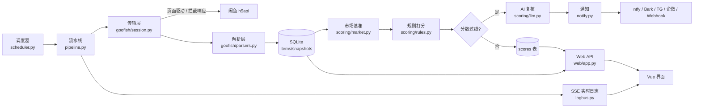

# 架构：把「监控」变成「决策」

## 1. 设计目标

1. **快**：30 条商品的完整一轮（搜索 + 详情 + 打分）控制在 1 分钟内，而不是 5 分钟。
2. **准**：不追求「过/不过」，而是给出 0–100 分和理由，让用户自己判断。
3. **省**：大模型只在头部候选上出现，且结果缓存；没配 AI 也能完整工作。
4. **可解释**：每个分数都能拆成「价格 / 成色 / 卖家 / 风险 / 加分」，界面上逐项可见。
5. **不脆弱**：筛选、翻页、详情都不依赖页面 DOM，前端改版不影响抓取。

## 2. 模块图



## 3. 一次扫描的数据流

1. `scheduler` 每 15 秒查 `watches.next_run_at`，到点且并发未满就起一个 `run_watch`。
2. `pipeline` 选账号 → `ensure_login`（浏览器页面常驻，不重复启动）。
3. 按页调 `mtop.taobao.idlemtopsearch.pc.search`，参数由 `SearchQuery` 拼（不点按钮）。
4. 列表卡按 `item_id` 全局 upsert；只有「首次进入该关注」或「价格变化」才写 `snapshots`。
5. 需要重算的商品（新上/降价/从未评分）才抓详情；详情有 6 小时缓存。
6. 市场基准：近 30 天该关注下所有商品的最新价，按**存储容量**分桶，取中位数/四分位并去极端值。
7. 规则打分 → 写 `scores` → 过线且「该商品该价格没推过」才通知。
8. 分数 ≥60 的前 N 条交给 AI 复核（可选），结果写回 `scores.llm_json`。
9. `runs` 记录本轮 found/new/scored/alerted 与错误；`logbus` 同时推 SSE 给界面。

## 4. 打分公式

```
score = 50
      + 价格分      (-30 … +32)   相对同规格中位价：低于 25% 吃满 32 分
      + 成色分      (-5.5 … +11)  几乎全新 0.95、95新 0.82、9成新 0.66、7成新 0.25
      + 卖家分      (-9 … +9)     信用等级 + 芝麻 + 实名 + 注册年限 + 回复率 - 在售数量
      + 新鲜度      (-2 … +6)     2 小时内 +6，72 小时以上 -2
      + 竞争        (-3 … +2)     想要人数 ≥30 扣 3
      + 加分项      (-6 … +6)     包邮、全套、电池健康、非国行扣分
      - 风险扣分    (0 … -30)     进水/非原装/有锁/主板维修 等
```

硬规则：

- 命中「进水 / 非原装 / 有锁 / 主板维修」→ 直接「放弃」，不论价格多低。
- 成色 ≤7 成新 → 分数上限 60；≤9 成新 → 上限 74。
- 分档：≥80 强烈推荐 · 65–79 值得看 · 50–64 观望 · <50 放弃。

否定语义与例外：

- 「无拆修 / 未进水 / 没有维修」不算风险（前缀否定）。
- 「二手贩子勿扰 / 非商家」不算商家（后缀否定）。
- 「同城也可自提」但描述里有「包邮/可邮寄」→ 不算仅自提。

## 5. 关键决策（ADR）

### ADR-1 页面驱动 + 拦截响应，而不是裸 HTTP 或脆弱直调

裸 HTTP 手算 `sign` 会被风控（`RGV587_ERROR::SM`）。页面内 `window.lib.mtop.request`
虽然一度可用，但闲鱼改版后直调请求会缺少签名参数、稳定回 `TIMEOUT::接口超时`
（页面自己的请求仍正常）。所以搜索改为：导航 `/search?q=…`，拦页面自己发出的搜索响应；
详情只为新商品开一个临时页，拦详情响应后关闭。直调仅作兜底。

### ADR-2 无头浏览器 + 移动端仿真

上下文用移动端仿真（Android UA、`is_mobile`、`has_touch`、手机视口），桌面 UA 在闲鱼
登录页会被判「非法访问」。搜索与详情都走页面驱动，因此不需要任何可见窗口；
只有扫码登录时才临时建一个桌面形态的可见上下文，登录态存盘后关闭，
下一轮抓取再回到无头。直调兜底前会先做一次页面预热。

### ADR-3 全局按 item_id 去重

`items.item_id` 是主键；换个搜索词命中同一件商品，不会重复抓详情、重复推送。
`scores` 按 `(item_id, watch_id)` 存，同一商品在不同关注下有不同分数。

### ADR-4 规则先行，AI 复核

规则分是确定性的、免费的、毫秒级的；AI 只处理「值得看」以上的前 N 条，
输出「结论 / 缺失信息 / 该问卖家什么」，写回 `scores.llm_json` 作为补充而不是结论本身。
没配 key 时整条链路照常工作。

### ADR-5 市场基准按存储容量分桶

12+256 和 16+512 不是同一个市场。用标题/标签里的存储容量做桶，
样本 ≥4 才用同桶中位数，否则退回全量并在界面上写明「依据」。

### ADR-6 告警按「商品 + 价格」去重

分数每次重算都会微调；如果按分数去重，同一商品会被反复推送。
`alerts` 的唯一键是 `(item_id, watch_id, price)`，只有降价才会再次提醒。

### ADR-7 不做假鉴权

只绑 `127.0.0.1`，明确声明是单机工具，不做「前端存个标记就算登录」的假鉴权；
要远程访问请自己套 Nginx + Basic Auth / Tailscale。

## 6. 并发与自保

| 项 | 值 | 说明 |
|---|---|---|
| 每次 mtop 调用间隔 | 0.35s + 0–150ms 抖动 | `hunter/goofish/session.py` |
| 详情并发 | 3 | `HUNTER_DETAIL_CONCURRENCY` |
| 同时运行的关注 | 2 | `Scheduler(max_parallel=2)` |
| 卖家主页抓取 | 每轮最多 10 个 | 只补信用文案，不阻塞主流程 |
| 详情缓存 | 6 小时 | 价格变化会绕过缓存 |
| 风控命中 | 立即停止该关注 + 标记账号 | 不重试、不换号硬刚 |

## 7. 失败模式

| 情况 | 表现 | 处理 |
|---|---|---|
| 登录态过期 | 页面跳 passport | `LoginRequired` → 账号标 `expired` → 界面提示扫码 |
| 触发验证码 | `RGV587` / `FAIL_SYS_USER_VALIDATE` | `RiskControl` → 停止 + 建议冷却 1–2 小时 |
| token 过期 | `FAIL_SYS_TOKEN_EXOIRED` | 刷新页面重取 `_m_h5_tk`，重试 1 次 |
| 接口超时 | `TIMEOUT::接口超时` | 判定会话卡死 → 关闭并重建浏览器上下文 → 重试 1 次；仍失败则冷却 |
| 业务错误 | `FAIL_BIZ_*` | 记录到 `runs.error`，不重试 |
| 详情单条失败 | 该商品跳过 | 打 warn，不影响其它商品 |
| AI 超时/报错 | `llm_json` 里记 error | 采集与规则分不受影响 |

## 8. 目录

```
hunter/
  config.py        路径 / 运行时参数
  models.py        Watch / ItemCard / ItemDetail / SellerInfo / MarketStats / ScoreResult
  db.py            schema + 迁移 + 连接
  repo.py          所有 SQL
  pipeline.py      一次扫描的编排
  scheduler.py     asyncio 调度
  notify.py        渠道 + 去重 + 静默时段
  login.py         扫码登录 / 登录态导入
  logbus.py        事件总线（文件 + SSE）
  goofish/
    session.py     浏览器与 mtop 调用、风控分类、token 刷新
    query.py       搜索条件 → 请求体
    parsers.py     原始 JSON → 领域模型
    api.py         搜索 / 详情 / 卖家
  scoring/
    market.py      分桶市场基准
    rules.py       可解释打分
    llm.py         AI 复核（可选）
  web/app.py       FastAPI + SSE + 静态资源
  cli.py           init / serve / login / add / run / ls / doctor
webui/             Vue 3 + Vite + Tailwind
tests/             解析 / 参数 / 市场 / 打分 / 数据层
docs/              接口笔记、架构、验收记录、接口契约
```

## 9. 测试策略

- **解析器**：吃真实接口响应（`tests/fixtures/*.json`），不改代码就知道字段有没有变。
- **搜索参数**：把实测请求体写进断言，字符串必须逐字一致。
- **市场基准**：同规格优先、样本不足回退、极端值裁剪。
- **打分**：好货高分、进水劝退、贵货低分、商家/标题不符扣分。
- **数据层**：全局去重、按关注隔离分数、反馈读写。
- 不 mock 业务逻辑本身——只 mock 网络边界。
